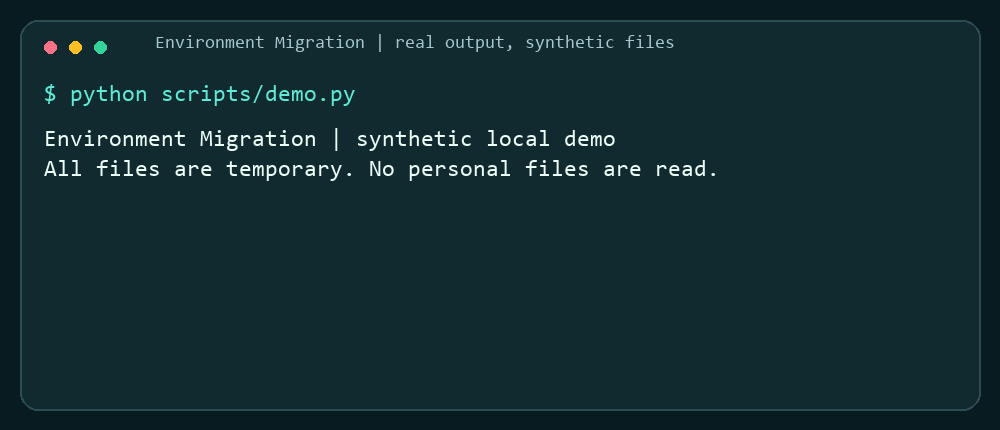

# Environment Migration

[](https://github.com/Alvolutionor/environment-migration/actions/workflows/test.yml)
[](https://skills.sh/alvolutionor/environment-migration/environment-migration)
[](LICENSE)

**Moving to a new computer? Ask your coding agent to discover your setup, package what matters, and preview restoration before writing files.**

Works with Codex and Claude Code as a standalone skill or plugin. The workflow separates portable files, rebuildable dependencies, native service exports, and device-bound credentials. It makes no assumptions about usernames, drive letters, or installation paths.

The bundled Python transport packages selected files with SHA-256 checks, preserves empty directories, and refuses to overwrite differing destination files. Software installation and service imports are guided native procedures, not automated adapters.



The animation renders output from the real synthetic demo. Reproduce it with Python 3.10 or later:

```sh
python scripts/demo.py
```

## Install

Choose one installation method to avoid loading duplicate skills.

**One command with skills.sh** (requires a Node.js version supported by its CLI; tested CLI 1.7.2 requires Node 22.20 or later):

```sh
npx skills add Alvolutionor/environment-migration --skill environment-migration
```

**Codex plugin** from this community repository marketplace:

```sh
codex plugin marketplace add Alvolutionor/environment-migration
codex plugin add environment-migration@alvolutionor-tools
```

**Claude Code plugin** from the same repository:

```sh
claude plugin marketplace add Alvolutionor/environment-migration
claude plugin install environment-migration@alvolutionor-tools
```

These are community repository installations. They do not imply approval or listing in either vendor's official directory.

**Without Node.js:** clone directly into your agent's skills directory under the name `environment-migration`. For Codex:

Windows PowerShell:

```powershell
git clone https://github.com/Alvolutionor/environment-migration.git "$env:USERPROFILE/.codex/skills/environment-migration"
```

macOS or Linux:

```sh
git clone https://github.com/Alvolutionor/environment-migration.git ~/.codex/skills/environment-migration
```

For Claude Code replace `.codex/skills` with `.claude/skills`. Other agents that support `SKILL.md` can load the repository's [entrypoint](SKILL.md). Avoid installing over an existing directory.

## Use

Ask your agent:

> Use environment-migration to prepare a migration package for my new computer. Discover my current setup first, ask about unresolved scope choices, include the restoration tools, and stop only after package verification. Do not restore onto this machine.

Or invoke `$environment-migration` in an agent that supports named skill invocation. See [transport commands and configuration](references/transport.md) for using the helper directly.

## What you get

| Stage | Result |
| --- | --- |
| Discover | Explicit scope, prerequisites, exclusions, and capability inventory |
| Capture | Native service exports plus selected portable files |
| Verify | Archive and per-file SHA-256 checks |
| Map | Independent destination folders for logical source roots |
| Preview | Missing files and conflicts reported before applying |
| Restore | Verified file copies; existing differing files preserved |
| Validate | File integrity and clearly separated application smoke tests |

## Compatibility and limits

The workflow covers Windows, macOS, Linux, and cross-OS rebuilding decisions. The transport requires Python 3.10+ and transports regular files and empty directories. It intentionally rejects links, special files, and unapproved SQLite state; completed SQLite exports require an explicit allowlist and integrity check. It does not preserve access-control lists, ownership, extended attributes, executable permissions, or OS credential bindings. Archives are unencrypted. Native exports and destination smoke tests are required for application migration.

Automated tests use synthetic temporary data only. The initial transport release passed Windows, macOS, and Linux CI with Python 3.10 and 3.13. The badge links to the current revision's results. Real application import coverage is separate from file transport validation.

```sh
python -m unittest discover -s tests -v
```

## Downloads, support, and publishing

Download standalone skill and portable plugin ZIPs from [Releases](https://github.com/Alvolutionor/environment-migration/releases). Portable plugin ZIPs use the standard `skills/environment-migration/` layout and declare that local execution is required. [Submission instructions and channel status](publishing/README.md) distinguish public distribution from pending vendor review.

Read [Privacy](PRIVACY.md) before selecting sensitive files. Report reproducible issues with synthetic data in [GitHub Issues](https://github.com/Alvolutionor/environment-migration/issues). Never upload a real migration payload or credential inventory.

Created and maintained by [Alvolutionor](https://github.com/Alvolutionor). If you try it, share your source/destination OS, what worked, and any reproducible failure. Successful migration reports help prioritize the next native adapters.

Licensed under [MIT](LICENSE).
